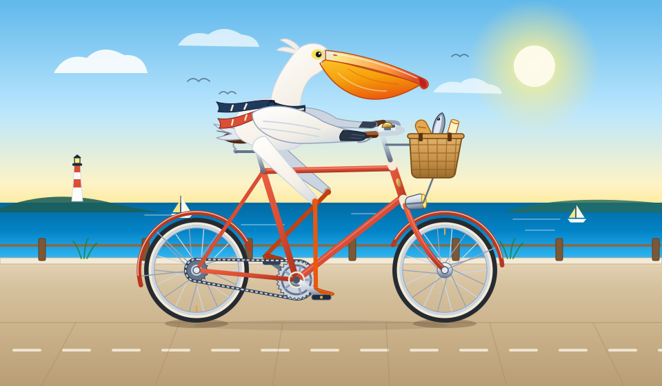

<!-- 署名: Antigravity (GitHub: jian8111 / Drive共享绑定: 466788455@qq.com · 待确认 ~/.gemini/ACCOUNT_IDENTITY.txt) -->
# pro6 · 暮海港湾巡游鹈鹕（Pelican Riding a Bicycle）

使用纯矢量 **SVG + 零外部依赖单文件 HTML5** 构建的「鹈鹕骑自行车」第六版交互式插画，所有文件独立整理在 `pro6/` 目录中。



## 目录结构

```text
pro6/
├── README.md            # 本说明文档
├── index.html           # 零依赖单文件交互式 HTML5 + 内联 SVG 展示页
└── pelican-bicycle.svg  # 960×560 独立静态纯矢量 SVG 源文件
```

## 核心亮点

1. **朱红复古钢架与精确传动几何**
   - 按经典钻石三角钢架、`73°` 立管角、`360px` 轴距与 `76px` 乳白胎壁轮组建模，配备 `18` 根交叉编织辐条、前叉灯架、`28:16`（`1.75×`）切线链条传动、防锈挡泥板、弹簧皮鞍座与载有法棍/海鱼/航海图的前车篮。
   - 鹈鹕双腿由实时 **2-Bone Inverse Kinematics (IK)** 求解，全 360° 踩踏过程中膝角保持在舒适区间，地面虚线、铺装石缝与海岸栏杆按车轮线速度严格同步滚动（零打滑）。

2. **海港水手鹈鹕与彩蛋互动**
   - 舒展的 S 形颈部、迎风飘动的双色条纹水手围巾、金黄眼周斑与眨眼动画、钩状红喙尖与琥珀色弹性喉囊。
   - **互动彩蛋**：点击**黄铜车铃**（或按 `B`）触发 Web Audio 合成双音铃声与音符粒子；点击**鹈鹕喉囊**（或按 `F`）触发张喙扑腾并弹出银色小海鱼与水花。

3. **四套海港光影与工程蓝图模式**
   - **1. 海风晴空**：明朗海湾蓝天、灯塔与慢漂帆船。
   - **2. 琥珀日落**：暖橘暮色天际并自动点亮前叉复古车灯光束。
   - **3. 港湾星夜**：深蓝星月夜色、灯塔旋转探照光束与车前照明光锥。
   - **4. 工程蓝图**：建筑制图蓝底网格叠加实时 `Hip / Knee / Ankle` IK 向量与屈角遥测。
   - 支持 `Space` 启停、`→` / `.` 单步 `15°` 调试、`0.25×–2.50×` 踏频调节及一键复制 / 下载当前帧 SVG。

## 本地预览

直接用浏览器打开 [`pro6/index.html`](./index.html) 或 [`pro6/pelican-bicycle.svg`](./pelican-bicycle.svg) 即可离线运行。
